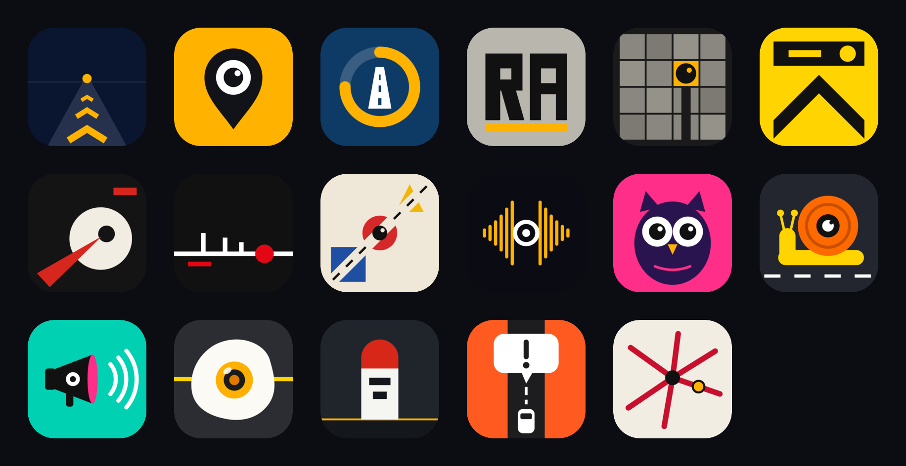
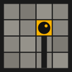
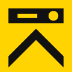
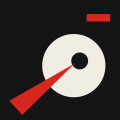
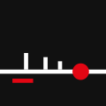
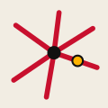
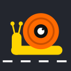

# Logo ideas

Seventeen app-icon concepts for Radares Anunciados, to choose from. Nothing here replaces the current app icon
(`App/Sources/Assets.xcassets/AppIcon.appiconset/AppIcon.png`) or the README banner (`docs/images/banner.svg`).
Pick one and it gets its own change.

## The brief

- The theme: Spanish roads, a radar announced ahead, the driver warned in time.
- The legal line shows in the drawing too. No icon draws a detector, an antenna or a received signal, and nothing
  radiates from the radar. The only waves are the voice: the waveform in 10 and the megaphone's sound in 13.
- Seven concepts carry the theme with no camera lens at all (01, 03, 04, 08, 15, 16, 17): distance, the road, the
  kilometre post, the spoken announcement and the Spanish road map.
- No official traffic sign is reproduced as it is, and no trademark is used.
- Every concept is a hand-written SVG on a 1024 × 1024 canvas, full bleed, with the important shapes kept clear
  of the iOS corner mask. Each one is also rendered at 60 px (`png/<name>-60.png`), the home-screen size at 1×,
  and was checked there: the shapes that carry each idea stay about 2 px wide or more. Lane dashes are the only
  finer detail.
- No text in any font. The only letters (concept 04) are rectangles and one polygon drawn here, so the repo ships
  no font outlines and no font licence applies.

## Refined

| | Concept | Why |
|---|---|---|
|  | **01 Horizonte** · [svg](01-horizonte.svg) | Amber chevrons run up the road from the driver to one point on the horizon. The warning goes ahead of you, so you reach the radar already knowing. |
|  | **02 Pin objetivo** · [svg](02-pin-objetivo.svg) | A map pin with a lens inside: a radar at a published place. The plainest way to say "positions, not detection". |
|  | **03 Cuenta atrás** · [svg](03-cuenta-atras.svg) | A countdown ring round the road ahead. The warning starts the clock early enough that the driver has time to spare. |
|  | **15 Hito** · [svg](15-hito.svg) | A Spanish kilometre post, drawn plain. Radars are published by road and kilometre point, so the post is the published position itself. |

## Brutalist

| | Concept | Why |
|---|---|---|
|  | **04 Bloque RA** · [svg](04-bloque-ra.svg) | The initials built from raw blocks on concrete grey, with one amber stripe for the warning. Heavy, flat, no decoration. |
|  | **05 Rejilla** · [svg](05-rejilla.svg) | A grid of concrete slabs, one turned amber with a lens on it, and a wide road cut through the slabs below it. The map is a grid and one cell matters. |
|  | **06 Losa y flecha** · [svg](06-losa-flecha.svg) | A black slab that stands for the camera over a massive chevron pointing up the road. Hard edges, two colours. |

## Avant-garde

| | Concept | Why |
|---|---|---|
|  | **07 Cuña roja** · [svg](07-cuna-roja.svg) | Constructivist: a red wedge drives into a pale circle with a dark lens. The wedge is the warning reaching you ahead of the radar. |
|  | **08 Suizo** · [svg](08-suizo.svg) | Swiss grid: you are the red bar, the radar is the red point on the line, and the ticks between count the distance down. Asymmetric and quiet. |
|  | **09 Bauhaus** · [svg](09-bauhaus.svg) | Three primary shapes on one diagonal road. The lens sits on the road inside the red circle: one point on the route that matters. |
|  | **17 Radiales** · [svg](17-radiales.svg) | The six national roads leaving Madrid, the shape every Spanish driver knows, with one amber point on one of them. |
|  | **10 Ondas de voz** · [svg](10-ondas.svg) | The app's warning is spoken, so the mark is a voice waveform with a lens at its centre. |

## Crazy

| | Concept | Why |
|---|---|---|
|  | **11 Búho** · [svg](11-buho.svg) | An owl with two camera lenses for eyes on hot pink. It watches the road so you do not have to. |
|  | **12 Caracol** · [svg](12-caracol.svg) | A snail whose shell is a lens, crawling along the lane line. Radar ahead: snail speed. |
|  | **13 Megáfono** · [svg](13-megafono.svg) | A megaphone shouting the warning out loud, because the app announces the radar with a voice. |
|  | **14 Huevo frito** · [svg](14-huevo-frito.svg) | A fried egg on the asphalt whose yolk is a lens. Miss the warning and you are "frito". |
|  | **16 Aviso a tiempo** · [svg](16-aviso-a-tiempo.svg) | A small car and a huge speech bubble far up the road. The app talks to you, and it talks with road to spare. |

## Rendering

`render.sh` turns every SVG into `png/<name>-1024.png`, `png/<name>-120.png` and `png/<name>-60.png` and builds
`contact-sheet.png` (rows of six, each icon under the iOS corner mask, on a dark background). It needs
`rsvg-convert` (librsvg) and ImageMagick 7: `brew install librsvg imagemagick`. It picks up any `NN-name.svg` in
this folder, so a new concept needs no change to the script.
